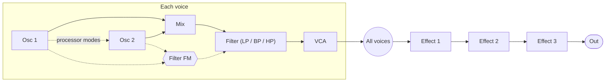

# Bizar

Bizar is a two-engine hybrid synthesizer for [Ableton Move](https://www.ableton.com/move/),
running as a sound-generator module in [Schwung](https://github.com/charlesvestal/schwung).
Two digital oscillators with more than two dozen engines each, a resonant filter, two LFOs, a Cycling Envelope,
a 12-column modulation matrix, four macros, three effect slots, a sequencer and an arpeggiator,
and 128 original presets, all playable from Move's knobs and pads.

- **Play it in your browser:** <https://klaine.github.io/bizar/> (the same DSP compiled to
  WebAssembly, with WebMIDI)
- **Download for Move:** [latest release](https://github.com/klaine/bizar/releases/latest)
- **Every page and knob:** [PARAMETER_REFERENCE.md](PARAMETER_REFERENCE.md)
- **Every preset:** [docs/PRESETS.md](docs/PRESETS.md)
- **What changed:** [CHANGELOG.md](CHANGELOG.md)

Bizar takes its workflow from two-engine performance synths such as Arturia's MiniFreak. It is
not an Arturia product and is not affiliated with Arturia, and it contains no Arturia code,
firmware, presets or samples. Several engines are adapted from Emilie Gillet's Plaits (MIT); see
[THIRD_PARTY_NOTICES.md](THIRD_PARTY_NOTICES.md).

## Installing on Move

Bizar needs a Move with [Schwung](https://github.com/charlesvestal/schwung) installed.

1. Download `bizar-module.tar.gz` from the
   [latest release](https://github.com/klaine/bizar/releases/latest).
2. Install it with Schwung Manager, or by hand: extract the archive so that it lands at
   `/data/UserData/schwung/modules/sound_generators/bizar/` on the Move.
3. Rescan modules in Schwung Manager, or restart Schwung.

Bizar then appears under Sound Generators as **BIZR**.

Developers with SSH access can install a local build with `sh scripts/deploy.sh`
(macOS and Linux) or `scripts/install-windows.ps1` (Windows, see
[Building from source](#building-from-source)). Both stage the files on the Move's data
partition and rename them into place, so a running Schwung is not disturbed.

## How it works

The signal path is one voice of a classic hybrid synth, six times over:



Everything below is reachable from Move's parameter pages, and most of it from the Remote UI
too.

### Oscillators

Each oscillator has **Type**, **Wave**, **Timbre**, **Shape**, **Tune** and **Volume**. The three
timbre knobs mean something specific to each engine, and the page relabels them when the type
changes (a wavetable engine's Wave knob becomes Position, for example).

**Oscillator 1** chooses from BasicWaves, Two Op FM, Wavefolder, Noise, Wavetable, SuperWave,
Harmo, Formant, V.Analog, Waveshaper, Chords, KarplusStr, SawX, Harm, Bass, Modal and Speech.

**Oscillator 2** has the same generators plus processor modes that work on Oscillator 1's
signal: Ring, Wavefolder, MultiFilter, Crusher, Comb Filter, Surgeon Filter, Phaser Filter,
Destroy and FM / RM. That is where the "hybrid" comes from: Osc 2 can be a second voice or a
treatment of the first.

The **Wavetable** engine picks one of 32 banks of 64 frames each (from the CC0 WaveEdit Online
collection, listed in [assets/wavetables/README.md](assets/wavetables/README.md)), with
anti-aliased mip levels. Each oscillator also has a **Mod Quantize** setting that snaps its pitch
modulation to a scale, for sequenced and sample-and-hold pitch lines that stay in key.

### Filter and envelopes

A per-voice resonant filter with low-pass, band-pass and high-pass modes, envelope amount and
audio-rate **Filter FM** from Osc 1, Osc 2 or their mix. The ADSR envelope has Default/Quick
attack and Default/Percussive decay and release curves, and a retrigger switch. A Velocity
Targets page sets how velocity reaches the VCA, the filter, envelope depth and envelope time.

### Modulation

- **Two LFOs** with nine shapes (Triangle, Saw, Square, an editable eight-point Shaper curve,
  Sine, S&H, Slew S&H, ExpSaw, ExpRamp), tempo sync over 27 divisions, and Free, Poly, Mono,
  Legato and One-shot retrigger modes. Synced LFOs follow Move's transport.
- **Cycling Envelope**, a looping Rise/Hold/Fall generator with Env, Run and Loop modes.
- **Modulation matrix** of twelve destination columns fed by seven sources: Cycling Envelope,
  Envelope, LFO 1, LFO 2, Velocity + Aftertouch, Wheel and Key Track. A matrix cell can itself be
  a destination, so one source can scale another's depth.
- **Four macros**, each driving up to four destinations with its own amounts.

### Effects

Three stereo slots in series. Each slot picks a type and then a preset for that type:

| Type | Presets |
|---|---|
| Delay | Digital, Stereo, Ping-Pong, Mono, Filtered, Filtered Ping-Pong, Tape, each also as a tempo-synced version |
| Reverb | Default, Long, Hall, Echoes, Room, Dark Room |
| Chorus | Default, Lush, Dark, Shaded, Single |
| Phaser | Default, Space, SnH, each free or synced |
| Flanger | Default, Silly, each free or synced |
| Super Unison | Classic, Ravey, Soli, Slow, Slow Trig, Wide Trig, Mono Trig, Wavy |
| Drive | Classic, Soft Clip, Germanium, Dual Fold, Climb, Tape |
| Crusher, 3-Band EQ, Peak EQ, Multi Comp | Bit crushing, a three-band EQ, a parametric peak and a three-band compressor |

### Voices and playing

Six-voice polyphony, plus Mono and Unison modes (mono or poly stacks with spread) and a
keyboard **Chord** mode that plays up to five intervals from one key. Bizar responds to
velocity, pitch bend, channel pressure, polyphonic aftertouch, the mod wheel and the sustain
pedal.

### Sequencer and arpeggiator

Both are clocked from Move's tempo and start when you hold keys:

- **Seq** plays a pattern of up to 64 steps with up to six notes per step, transposed by the
  last key held.
- **Arp** plays the held keys Up, Down, Up/Down, Random, in played order, as a chord or Poly,
  over one to four octaves.

Rate is a 15-entry division list with gate and swing. Up to four automation lanes each aim at a
modulation destination and hold one value per step, stepped or smoothed. The sequence is edited
in the Remote UI and saved with the patch.

### Presets

128 original presets, sixteen in each of eight categories. Each name starts with a two-letter
tag so the list is easy to browse on Move's display:

| Tag | Category | Tag | Category |
|---|---|---|---|
| `BA` | Bass | `PD` | Pads |
| `LD` | Leads | `PL` | Plucks and mallets |
| `KY` | Keys | `AR` | Arpeggios and sequences |
| `PY` | Polysynths and brass | `FX` | Effects, drones and percussion |

Every preset shares the same two macros, so the whole bank plays the same way: **Macro 1,
Timbre** opens the filter and moves the engines' signature controls with it, and **Macro 2,
Space** raises the delay, reverb and release. Presets built on an LFO add **Macro 3, Motion**,
the LFO's depth. The macros start at zero, where the preset sounds as designed. `PY Init` is a
plain saw to start from.

## On Move

Bizar's parameter pages, in order: Main (macros, output, cutoff, resonance, attack and release),
Factory Patches (it steps through the category that the next page, Patch Category, picks), Patch
Category, Oscillator 1, Oscillator 2, Filter, Envelope, Velocity Targets, Cycling
Envelope, LFO 1 and LFO 2 (each with a Curve page for the Shaper), Mod Matrix, Matrix Editor,
Macros and the four Macro Slots pages, Effect 1 to 3, Voice, Chord and Settings. Each page shows
up to eight knobs; controls that only apply to the current engine or effect are hidden until it
is selected. [PARAMETER_REFERENCE.md](PARAMETER_REFERENCE.md) lists every page with its ranges
and defaults.

Patches are saved and automated through Schwung like any other module. The **Remote UI**, served
by Schwung in a browser, adds what a small screen cannot: knobs for everything, draggable
envelope and Shaper curves, a filter response view, waveform previews, the full modulation
matrix with hardware-style mod assign, the sequencer editor, undo and redo, a patch browser
with categories, favourites and your own patches, A/B compare, patch export and import, and
share links that carry the patch in the URL.

## Playing in the browser

<https://klaine.github.io/bizar/> is the whole synth as a single page: the Remote UI plus the
same DSP compiled to WebAssembly. Click **Start Bizar**, then play from a WebMIDI device (Chrome
or Edge; Firefox needs a MIDI add-on), from the computer keyboard in Live's layout (A to K are
the white keys, W E T Y U O P the black ones, Z and X shift octaves, C and V velocity), or from
the on-screen keyboard. A BPM box drives the synced LFOs and the sequencer, the MIDI menu picks
the input and channel and can follow MIDI clock, and Alt-click (or L) on a knob learns a MIDI
controller. Your sound is kept in the browser and restored on the next visit.

## Building from source

Requirements: a POSIX shell, Python 3, and for the device build either an AArch64 cross
compiler (`aarch64-linux-gnu-gcc`, or set `CC`) or [zig](https://ziglang.org/), which the
build falls back to as `zig cc`. The web build needs zig.

```bash
sh scripts/build.sh
```

This writes `dist/bizar/` (the module directory), `dist/bizar-module.tar.gz`, the same bytes as
`dist/bizar-module-<version>.tar.gz`, and `dist/bizar-web.html` when zig is available.

Other targets:

```bash
CC=cc sh scripts/build.sh --test        # desktop DSP and integration tests
sh scripts/build.sh --reference         # regenerate PARAMETER_REFERENCE.md and docs/PRESETS.md
sh scripts/build.sh --web               # browser build only
sh scripts/deploy.sh                    # install the build on a Move over SSH
```

Without a local toolchain, `scripts/Dockerfile` builds a container with everything needed, and
`scripts/build-windows.ps1` runs the same build from PowerShell with Docker Desktop.
`scripts/install-windows.ps1` installs the result on a Move from Windows.

The parameter reference and preset list are generated from the module's own contract, and CI
fails if the committed copies are stale, so they cannot drift from the code. See
[CONTRIBUTING.md](CONTRIBUTING.md) before opening a pull request.

### Using your own MiniFreak presets

If you own a MiniFreak, you can compile an exported `.mnfx` bank into a personal build:

```bash
MINIFREAK_BANK=private/MyBank.mnfx sh scripts/build.sh
```

Such a build is written as `dist/bizar-module-personal.tar.gz` and must not be shared or
published. [docs/MINIFREAK_IMPORT.md](docs/MINIFREAK_IMPORT.md) has the export steps and what
the importer covers.

## Status

Bizar is a beta. Known gaps:

- The **Sample, Particles, Cloud Grains, Hit Grains, Frozen, Skan, Lick, Raster** and
  **Audio In** engine types load and respond to their knobs but play a placeholder tone. They
  need an asset-loading and audio-input model that keeps file I/O off the audio thread.
- No vocoder effect and no user wavetable import.
- **Modal** is struck only; a sustained, dust-excited mode is not wired up.
- The three effect slots always run in series. There is no per-slot send routing.

Bug reports and ideas are welcome as [issues](https://github.com/klaine/bizar/issues).

## Project layout

| Path | Contents |
|---|---|
| `src/bizar.c` | Plugin adapter: parameters, pages, state, presets, voice allocation and rendering |
| `src/engines.c`, `effects.c`, `filter.c`, `modulation.c`, `voice.c`, `sequencer.c` | Allocation-free DSP |
| `scripts/generate_factory_bank.py` | The 128 factory presets, compiled into the module at build time |
| `scripts/generate_wavetables.py` | Converts the CC0 wavetables into mip levels |
| `web_ui.html`, `web_ui_extras.js` | Remote UI |
| `web/` | Browser build: WebAssembly glue, host shim and bundler |
| `tests/test_plugin.c` | Desktop DSP and integration tests |
| `tools/` | Contract dump, factory level meter and preset renderer |
| `include/` | Schwung ABI declarations, so the module builds without a Schwung checkout |

The module does no file I/O and no heap allocation in its audio callbacks. Engine and effect
indices are part of the patch format, so new ones are appended and older patches are migrated on
load.

## License

MIT, see [LICENSE](LICENSE). Parts of the engines are adapted from Plaits (MIT) and the built-in
wavetables are CC0 1.0; see [THIRD_PARTY_NOTICES.md](THIRD_PARTY_NOTICES.md) and
[assets/wavetables/README.md](assets/wavetables/README.md). Schwung and Ableton Move are
separate projects under their own licenses.
